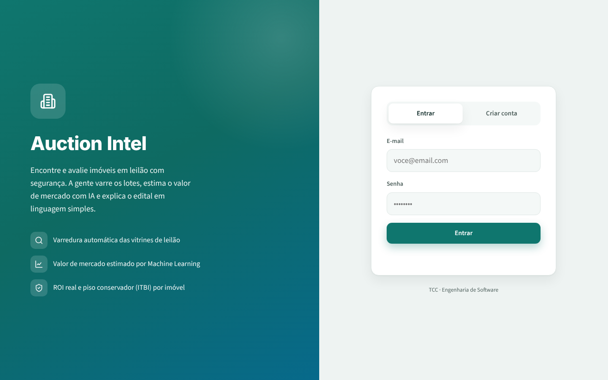
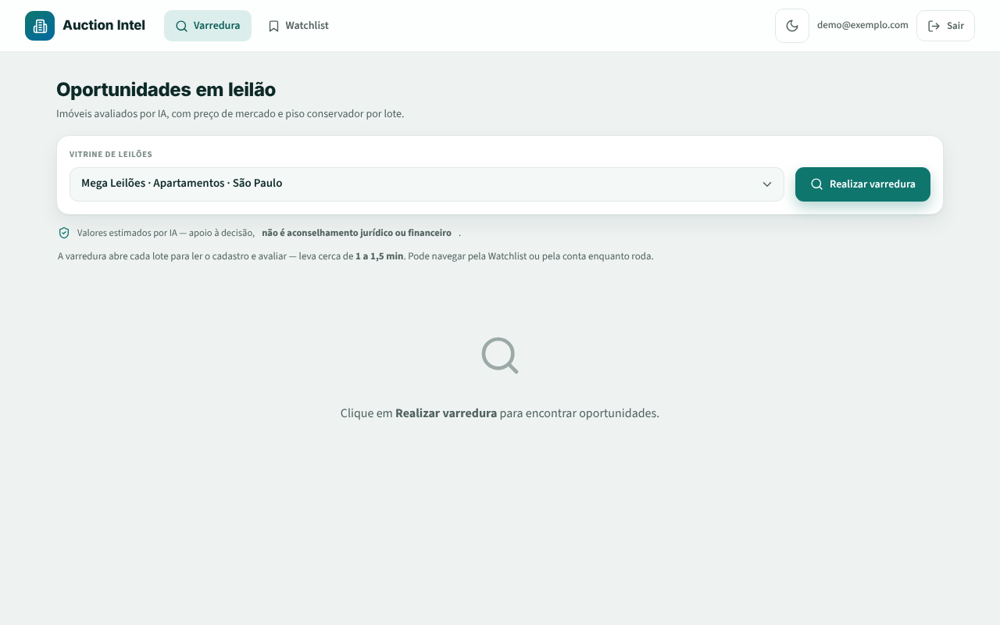
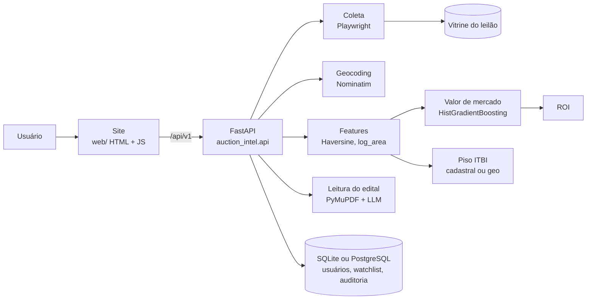

# Auction Intel

Estima o valor justo de imóveis de leilão em São Paulo com machine learning, compara com o lance, calcula o ROI e lê o edital com um LLM.

> **In English:** Auction Intel scrapes São Paulo real-estate auction listings, estimates each property's fair market value with a gradient-boosting model (R² 0.88 on log price, MAPE 20.7% on a held-out set of 2,483 apartments), compares it with the current bid to rank opportunities by ROI, and uses an LLM to turn the auction notice and property record into a plain-language risk report. FastAPI backend, vanilla JS frontend, scikit-learn, Playwright.

[](https://github.com/guihborro/Auction-Intel/actions/workflows/ci.yml)

## Demo

| Tela inicial | Painel de varredura |
| --- | --- |
|  |  |

`TODO(Guilherme): print ou GIF do painel com os lotes avaliados e do dossiê do edital.`

## Problema

Leilões de imóveis podem ter descontos grandes, mas avaliar cada lote dá trabalho. É preciso estimar quanto o imóvel vale de verdade, descontar comissão, impostos e dívidas que passam para o arrematante, e ler um edital jurídico longo para descobrir se o imóvel está ocupado ou tem pendências. Quem olha dezenas de lotes por semana não consegue fazer isso à mão para todos.

## Solução

1. **Catálogo:** um robô com Playwright percorre a vitrine do leilão (com paginação) e extrai área, bairro, lance, quartos e vagas de cada lote.
2. **Valor justo:** um modelo de gradient boosting estima o **valor de mercado** do imóvel. Um segundo modelo, treinado no preço realmente pago (ITBI), dá um **piso conservador**. O resultado é uma faixa, não um número único.
3. **Comparação com o lance e ROI:** o valor de mercado é comparado com o lance atual e os lotes são ordenados pelo retorno potencial.
4. **Leitura do edital:** sob demanda, o sistema baixa o edital e a matrícula (PDF), extrai o texto e pede a um LLM um dossiê em linguagem simples: ocupação, dívidas (IPTU, condomínio, dívida ativa), ônus, tipo de leilão, nível de risco e glossário. O site mostra o **ROI real**, já descontando as dívidas herdadas.

## Resultados

Números do relatório de treino (`models/*_report.json`), os mesmos gravados nos metadados de cada modelo.

**Valor de mercado** (`models/market_model.pkl`)

| Métrica | Valor |
| --- | --- |
| Base | 12.411 apartamentos (preços de anúncio, Kaggle, abril de 2024) |
| Divisão | aleatória 80/20 (9.928 treino, 2.483 teste) |
| R² no teste (log do preço) | 0,879 |
| R² médio na validação cruzada (KFold 5, no treino) | 0,884 |
| MAE no teste | R$ 263 mil |
| MAPE no teste | 20,7% |

**Piso ITBI** (preço declarado nas transações de 2024)

| Modelo | Base | R² (log do preço) | MAE | MAPE |
| --- | --- | --- | --- | --- |
| Cadastral (`itbi_model.pkl`) | 60.067 transações de apartamentos | 0,837 | R$ 137 mil | 24,4% |
| Só geografia (`itbi_geo_model.pkl`) | ITBI 2024 | 0,819 | R$ 150 mil | 25,9% |

Como ler esses números:

- O R² é calculado sobre o **logaritmo do preço**, que é o alvo do modelo. O erro em reais é o MAPE: em média, a estimativa erra cerca de 21% do valor do imóvel.
- A validação é **aleatória**, não temporal: o teste mede a capacidade de generalizar para outros imóveis do mesmo período, não para preços futuros.
- A troca de base foi decidida por um comparativo entre bases com o mesmo protocolo (`training/compare_datasets.py`, resultado em `docs/resultados/compare_datasets_report.json`): a base antiga de 14.392 imóveis tinha R² de validação cruzada de 0,779; a base de 2024, restrita a apartamentos, chegou a 0,885.

## Arquitetura



A engenharia de features vive num módulo único (`auction_intel.features.engineering`), usado tanto no treino quanto na inferência, para evitar diferenças entre os dois. A normalização do bairro e o target encoding ficam dentro do próprio pipeline do scikit-learn.

## Stack

- **Python 3.11+**, [uv](https://github.com/astral-sh/uv) para dependências
- **FastAPI** e **Uvicorn**: API e servidor do site
- **scikit-learn**: HistGradientBoostingRegressor, TargetEncoder, validação cruzada e busca de hiperparâmetros
- **pandas** e **NumPy**
- **Playwright**: coleta dos lotes
- **PyMuPDF** e um LLM via endpoint compatível com OpenAI (Gemini, Mistral, OpenRouter): leitura do edital
- **SQLAlchemy**: SQLite local por padrão, PostgreSQL via `DATABASE_URL`
- **Frontend** em HTML, CSS e JavaScript puros, sem build
- **pytest**, **ruff** e **GitHub Actions**

## Como rodar

Com [uv](https://github.com/astral-sh/uv):

```bash
git clone https://github.com/guihborro/Auction-Intel.git
cd Auction-Intel
uv sync
uv run playwright install chromium
cp .env.example .env
uv run uvicorn auction_intel.api.main:app --reload
```

Ou com pip:

```bash
python -m venv .venv
source .venv/bin/activate          # Windows: .venv\Scripts\activate
pip install -e .
playwright install chromium
cp .env.example .env               # Windows: copy .env.example .env
uvicorn auction_intel.api.main:app --reload
```

- Site: http://localhost:8000
- Documentação da API (Swagger): http://localhost:8000/docs

Os três modelos usados pela aplicação já estão em `models/`. Eles foram gravados com **scikit-learn 1.8.0**, versão fixada no `pyproject.toml`.

A leitura do edital é opcional: preencha `LLM_API_KEY` no `.env` para ativá-la. Sem chave, essa rota responde "não configurado" e o resto do app funciona normalmente.

**Docker:** `docker compose up --build` sobe a mesma imagem usada no deploy, em http://localhost:8000. O passo a passo para o Hugging Face Spaces está em [docs/deploy_huggingface.md](docs/deploy_huggingface.md).

**Testes e lint:**

```bash
uv run pytest
uv run ruff check .
uv run ruff format --check .
```

Os testes não acessam a rede: a rota de varredura é testada com dublês do scraper e dos modelos.

### Dados e retreino

Os dados brutos não ficam no repositório: são grandes e, no caso de editais e matrículas, têm dados pessoais. Os scripts de `training/` leem e gravam em `datasets/` (ignorada pelo Git) e devem ser rodados da raiz do repositório.

| Arquivo esperado em `datasets/` | Origem | Usado por |
| --- | --- | --- |
| `sp_2024_image_based.csv` | Kaggle, *Image-Based Property Price Prediction in São Paulo* (abril de 2024), baixado manualmente | `build_dataset_2024.py` |
| `dataset.csv` | base antiga de anúncios de São Paulo | `filter_under_7m.py` |
| `itbi_YYYY.xlsx` | Prefeitura de São Paulo, guias de ITBI pagas | `download_itbi_years.py`, `build_iptu_index.py` |
| `itbi_2024_apartments.csv` | guias de ITBI de 2024 da Prefeitura de São Paulo, filtradas para apartamentos. Esse preparo foi feito fora do repositório e o script não foi versionado | treino do piso ITBI, `build_sql_coords.py` |

Ordem para retreinar o modelo de mercado:

```bash
uv sync --group training
uv run python training/filter_under_7m.py        # base antiga -> centroides de bairro
uv run python training/build_dataset_2024.py     # normaliza a base de 2024
uv run python training/train_market_model.py     # treina e grava models/market_model.pkl
```

Piso ITBI: `download_itbi_years.py`, `build_iptu_index.py`, `build_sql_coords.py`, `train_itbi_model.py` e `train_itbi_geo_model.py`.

## Estrutura do repositório

```text
├── src/auction_intel/
│   ├── api/             FastAPI: app, rotas (análise, auth, watchlist, health)
│   ├── collection/      coleta dos lotes (Playwright) e geocoding
│   ├── features/        distâncias, log_area e normalização de bairro
│   ├── model/           valor de mercado e piso ITBI
│   ├── roi/             cálculo de retorno
│   ├── edital/          leitura do edital e da matrícula com LLM
│   ├── db/              SQLAlchemy (SQLite ou PostgreSQL)
│   ├── schemas/         modelos Pydantic de entrada e saída
│   └── config.py        configurações lidas do .env
├── web/                 site (HTML, CSS e JS puros)
├── models/              modelos treinados e relatórios de treino
├── training/            preparação dos dados e treino dos modelos
├── tests/               pytest
├── docs/                imagens, resultados do comparativo e guia de deploy
├── .github/workflows/   CI (ruff + pytest)
├── Dockerfile, docker-compose.yml
└── pyproject.toml, uv.lock
```

## Limitações e próximos passos

- **Preço de anúncio, não de venda.** O modelo de mercado aprende o preço pedido pelos vendedores, que tende a ser otimista. Por isso o piso ITBI aparece ao lado, como referência conservadora.
- **Só apartamentos.** A base de treino do valor de mercado é restrita a apartamentos; casas e terrenos ficam fora da distribuição do modelo.
- **Localização aproximada.** A base de 2024 não tem latitude e longitude: cada imóvel recebe o centroide do seu bairro. Na inferência, a coordenada também vem do bairro do anúncio.
- **Atributos inferidos.** Quando o anúncio não traz quartos, banheiros ou vagas, eles são estimados a partir da área.
- **Validação aleatória.** Não há teste com dados de um período posterior ao treino.
- **Uma vitrine.** A coleta está implementada para o Mega Leilões.
- **Próximos passos:** análise em lote com alertas de lotes novos, validação temporal, coordenadas por endereço no treino e outras vitrines de leilão.

## Autores

**Guilherme Haddad Borro** e **Luiz Eduardo Bacha dos Santos**. Trabalho de Conclusão de Curso de Ciência da Computação na Universidade Presbiteriana Mackenzie, com orientação do Prof. Dr. Gustavo Scalabrini Sampaio.
